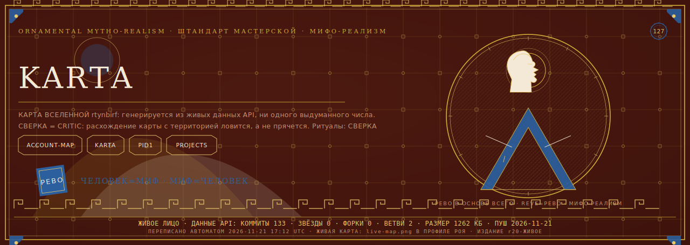

<div align="center">

<a href="https://github.com/rtynbirf/karta"></a>

</div>

<!--ФОРЖ:МУЗА:НАЧАЛО-->
<div align="center">
  
  <br/>
  
</div>
<!--ФОРЖ:МУЗА:КОНЕЦ-->

<!--ФОРЖ:ПАСПОРТ:НАЧАЛО-->
<div align="center">
  
</div>

| ФАЙЛОВ | ПАПОК | КОММИТОВ | ОБНОВЛЕНО | РЕЛИЗОВ |
|---:|---:|---:|---|---:|
| 61 | 15 | 191 | 2026-11-28 | 0 |
<!--ФОРЖ:ПАСПОРТ:КОНЕЦ-->

# КАРТА ВСЕЛЕННОЙ RTYNBIRF

<p align="center"></p>

> сгенерировано `2026-11-27T12:42:52Z` скриптом `scripts/gen_karta.py` (v3) из живых данных API
> правило: **НИ ОДНОГО ВЫДУМАННОГО ЧИСЛА** — карта не пишется руками, карта считается
> карта может отставать от территории — поэтому у карты есть раздел СВЕРКА

## СВОДКА

| метрика | живое значение |
|---|---|
| репо всего | **84** |
| живые | **83** |
| окаменелости (archived, сохранены как доказательства) | **1** |
| форки (чужая кровь, не вселенная) | 1 |
| нераздекодированные (честная дыра карты) | 18 |
| именованные кластеры | 10 |
| коммитов всего | **12811** |
| коммитов в живых репо | 12739 |
| объём вселенной | 1536.5 МБ |
| карта в счёте территории | **ДА** — «karta» орган вселенной и считается (решение рекогносцировки 16.11) |

## ЖИВЫЕ РЕПО (не archived)

| репо | кластер | коммитов | размер | назначение (описание API) |
|---|---|---|---|---|
| [rtynbirf](rtynbirf) | АККАУНТ-ОБОЛОЧКА | 693 | 25303 KB | ЧЕЛОВЕК=АККАУНТ=PID1 · ПОЛИМАТ=МУЛЬТИАГЕНТ · живая кузня: рой агентов, офлайн-вселенная, ни одного стороннего виджета |
| [.github](.github) | АККАУНТ-ОБОЛОЧКА | 517 | 5114 KB | .github — дефолтные community health files |
| [cell-swarm](cell-swarm) | РОЙ·ЯЧЕЙКИ | 510 | 5889 KB | РОЙ (Cell Swarm) — сингулярная эмерджентная архитектура: клетка, окно, указатели, храповик, семя |
| [markitdown](markitdown) | ФОРК | 503 | 10678 KB | MarkItDown |
| [H-PE11-PHOENIX](H-PE11-PHOENIX) | SINGULYAR | 410 | 17783 KB | PHOENIX-11: ворклог операций TH-* (журнал неповторимых результатов), сборки WinPE, сессии. Правила ведения — в rtynbirf/repo-doctrine. |
| [polymath-os](polymath-os) | ПОЛИМАТ-УЛЕЙ | 390 | 8768 KB | Personal sovereign media-OS. 5-layer LFS-style self-bootstrapping repo. SINGULYAR Emergent Intent Runtime v0.6. 35 ADRs. make verify 33/33. 290 tests green. |
| [repo-doctrine](repo-doctrine) | ДОКТРИНА·КАНОН | 364 | 5309 KB | Доктрина настройки GitHub-репозиториев: человеком для человека. Чек-листы флагов, защита веток, токены, конвенции агентов, аварийные процедуры, карта аккаунта. |
| [index](index) | НЕРАЗДЕКОДИРОВАН | 351 | 2074 KB | SSOT-хаб: реестр проектов, проверенные SHA, конституция веса |
| [singulyar](singulyar) | SINGULYAR | 326 | 820789 KB | СИНГУЛЯР — офлайн-вселенная караоке RUVSON: 68 песен · 197 языков (цель 200) · ОРКЕСТРАТОР ·15 · хаб + 52 двери · PWA (офлайн, без слежки) |
| [khozyain](khozyain) | ЯДРО·ДЕКЛАРАЦИИ | 254 | 2663 KB | ХОЗЯИН ДОМА — аккаунт-уровневый автомат состояния: зелёные main, живые триггеры, ноль открытых состояний и ноль уведомлений. Слой 3 дома поверх repo-doctrine и domovoy-ritual |
| [cell65-host](cell65-host) | РОЙ·ЯЧЕЙКИ | 249 | 5547 KB | cell65-host — Антицензор (Chrome MV3): PAC/DNR/WebRTC-защита, hosts-блокировка, обход блокировок |
| [voice-atlas-llm](voice-atlas-llm) | АТЛАСЫ·ЭПОХИ | 213 | 168579 KB | Атлас-LLM: модель-эксперт по клонированию голоса (дизентанглмент, TTS/VC/SVC/SVS) — LoRA-обучение на корпусе атласа 2026, RAG, гейты качества |
| [polimat-hub](polimat-hub) | ПОЛИМАТ-УЛЕЙ | 212 | 107832 KB | POLIMAT-HUB: место сверок мультиагента-архитектора. Архитектура, журнал операций, пломбы, stdlib-инструменты. |
| [rtynbirf.github.io](rtynbirf.github.io) | АККАУНТ-ОБОЛОЧКА | 211 | 11097 KB | ЛАКОРНИЯ · MEGA-PLAYER SINGULYAR |
| [commons](commons) | НЕРАЗДЕКОДИРОВАН | 211 | 6651 KB | COMMONS — один организм из лучших открытых проектов: геном-спеки, синапсы MCP, кровь событий, иммунитет-лицензии. Органы остаются на upstream — единым становится обмен. ЦЕЛОЕ = ЧЕЛОВЕК > суммы частей. Провенанс: здесь нет ни байта чужого (REUSE 3.3). |
| [agryp](agryp) | ЯДРО·ДЕКЛАРАЦИИ | 209 | 2192 KB | agryp — неспящий супервизор агентов уровня PID 1 |
| [github-runbook](github-runbook) | ДОКТРИНА·КАНОН | 205 | 4615 KB | Ранбук: настройка GitHub-репозитория человеком для человека — все флаги Settings, ветки и защита (Free vs Pro), безопасность, проверенная API-шпаргалка, журнал верификации |
| [ruvson-lyrics](ruvson-lyrics) | РЕВО·ЭКСПОЗИЦИИ | 204 | 5800 KB | RUVSON — тексты 65 треков: черновики, пайплайн, финальный ZIP |
| [polymat-hive](polymat-hive) | ПОЛИМАТ-УЛЕЙ | 204 | 1687 KB | 🐝 Живой репозиторий-организм: экипаж автономных AI-агентов в GitHub Actions — Copilot, локальный GGUF-нейромозг или инстинкты. Открой issue — экипаж ответит. |
| [domovoy-tweaker](domovoy-tweaker) | ДОМОВОЙ | 203 | 5695 KB | ДОМОВОЙ / MEGA=TWEAKER — Windows tweaker as a state, not an event: change ledger, drift sentinel, per-feature undo, effect verification. PowerShell prototype. |
| [neutral-browser](neutral-browser) | РОЙ·ЯЧЕЙКИ | 191 | 7033 KB | Neutral Browser — НЕЙТРАЛЬНЫЙ БРАУЗЕР ПОЛЬЗОВАТЕЛЯ |
| [release-vault](release-vault) | РЕВО·ЭКСПОЗИЦИИ | 189 | 5707 KB | release-vault — Шифрованное хранилище релизных ассетов |
| [hologram](hologram) | РОЙ·ЯЧЕЙКИ | 189 | 2784 KB | осколок знает целое: Merkle-осколки + Рид-Соломон (Целое из любых k из n), 64 репо вселенной, стратегия слоёв |
| [combain-v2](combain-v2) | РОЙ·ЯЧЕЙКИ | 189 | 1616 KB | COMBAIN v2 — self-hosted messenger |
| [revo](revo) | РЕВО·ЭКСПОЗИЦИИ | 181 | 12374 KB | REVO — автономный прототип метода Reve: layout → render |
| [karta](karta) ⟵ сама карта | КАРТА·АВТОПОРТРЕТ | 177 | 1782 KB | КАРТА ВСЕЛЕННОЙ rtynbirf: генерируется из живых данных API, ни одного выдуманного числа. СВЕРКА = CRITIC: расхождение карты с территорией ловится, а не прячется. Ритуалы: СВЕРКА / ВЫЖИВАНИЕ / НОЧЬ-БЕЗ-СЕТИ. |
| [runtime-protocol](runtime-protocol) | ДОКТРИНА·КАНОН | 174 | 4966 KB | Клетка роя cell-swarm: исполнимая модель динамики узла (уравнение ρ̇, GENESIS_EXEC, VOLATILE_META, CANCER_FILTER). stdlib-only, офлайн. |
| [karaoke-dream](karaoke-dream) | РЕВО·ЭКСПОЗИЦИИ | 169 | 4779 KB | Браузерное караоке мечты: неон, гид-вокал, оценка голоса в реальном времени и Зелёный коридор — тональность подстраивается под певца. Vanilla JS + WebAudio, zero-dependency. |
| [edinyy-svod](edinyy-svod) | ДОКТРИНА·КАНОН | 168 | 2646 KB | ЕДИНЫЙ СВОД — Конституция Хозяина 4.2: основной закон стенда «ЕДИНЫЙ ХОЗЯИН», 98 статей, XIX глав, стенд singulyar_host v3.2. РЕВО В ОСНОВЕ ВСЕГО · REVE=РЕВО |
| [nous](nous) | РОЙ·ЯЧЕЙКИ | 162 | 4790 KB | НОУС — эмерджентное сингулярное репо: конституция для человека и агентов, ТЗ форжа ISO, дорожная карта, контур исполнения |
| [cell-rs](cell-rs) | РОЙ·ЯЧЕЙКИ | 158 | 4871 KB | Первая Rust-клетка роя: ядро контура сверки — Tolerance/reconcile/Phase, sha256, байт-цепь. Кровь одна во всех телах. |
| [ekspozicii](ekspozicii) | РЕВО·ЭКСПОЗИЦИИ | 156 | 14749 KB | КНИГА ЭКСПОЗИЦИЙ |
| [ekonomika](ekonomika) | АТЛАСЫ·ЭПОХИ | 149 | 12991 KB | КНИГА ЭКОНОМИКИ |
| [github-doctrine](github-doctrine) | ДОКТРИНА·КАНОН | 148 | 4770 KB | КНИГА ДОКТРИНЫ |
| [lean-canon](lean-canon) | ДОКТРИНА·КАНОН | 147 | 11192 KB | КНИГА LEAN-КАНОНА |
| [free-man](free-man) | ЯДРО·ДЕКЛАРАЦИИ | 146 | 2129 KB | FREE MAN 0.2.2 — browser autonomy for Chrome MV3. 108 tracker/ads/CNAME domains blocked 100% on-device. No account, no cloud, no telemetry. |
| [domovoy](domovoy) | ДОМОВОЙ | 144 | 18201 KB | КНИГА ДОМОВОГО |
| [polymath-core](polymath-core) | ПОЛИМАТ-УЛЕЙ | 143 | 54010 KB | КНИГА ПОЛИМАТ-ЯДРА |
| [invariant-manifest](invariant-manifest) | НЕРАЗДЕКОДИРОВАН | 143 | 3212 KB | МАНИФЕСТ ИНВАРИАНТА · FORK 3 · v0.2.3 · CONDITIONAL PASS · seed 7170 · stdlib-only · порождение должно мочь быть опровергнутым |
| [uace](uace) | ПОЛИМАТ-УЛЕЙ | 142 | 7261 KB | КНИГА UACE |
| [ruvson](ruvson) | РЕВО·ЭКСПОЗИЦИИ | 141 | 13857 KB | КНИГА RUVSON |
| [polimat-task174](polimat-task174) | ПОЛИМАТ-УЛЕЙ | 122 | 10101 KB | ПОЛИМАТ · TASK174 — протокол проверки канона по строкам: пломбы sha256, ловушки, Б25.8 приёмка чужаком. Канон v5.1.2 [В]; «ключ внутри» [О]; «протокол работает» [Н]. Прогон 3 — связка красной нити. |
| [door-zero](door-zero) | ЯДРО·ДЕКЛАРАЦИИ | 111 | 1680 KB | Door Zero: дверь без контента. PID 0 системы: удаление ломает boot. GET -> 204, POST/PUT -> 403 Void. |
| [code](code) | НЕРАЗДЕКОДИРОВАН | 110 | 1395 KB | Код дома: скрипты и снипеты — место по канону §4 |
| [lex-naturae](lex-naturae) | ДОКТРИНА·КАНОН | 110 | 1894 KB | Lex Naturae — claim/evidence ledger. Separates observations from hypotheses, philosophical principles and institutional rules. Machine-verifiable: CSV cell extraction, excerpt verification, SHA-256 artifact integrity, unit ranges, graph conflict detection. v0.7 — audited by Z.ai, 70/70 tests, BOM-tolerant. |
| [kb](kb) | НЕРАЗДЕКОДИРОВАН | 109 | 1567 KB | Знания дома: канон-тексты, гайды, досье — место по канону §4 |
| [fond-host](fond-host) | НЕРАЗДЕКОДИРОВАН | 102 | 1585 KB | CORS-хост минус-фонда дома (Н-10 · ADR-0007): Pages отдаёт ACAO:* для лестницы WebAudio плееров |
| [singulyar-llm](singulyar-llm) | SINGULYAR | 93 | 5076 KB | Локальная модель СИНГУЛЯРА: Qwen2.5-0.5B-Instruct GGUF частями + инструкционный слой (ОБУЧЕНИЕ). Веса Apache-2.0, генерация — в браузере человека. |
| [singulyar-a0-audit](singulyar-a0-audit) | ДОКТРИНА·КАНОН | 92 | 2320 KB | SINGULYAR × A0 — independent audit (PACKAGE VALID + BRIDGE VALID) and R4 port design |
| [ruvson-rse2](ruvson-rse2) | РЕВО·ЭКСПОЗИЦИИ | 87 | 4869 KB | RUVSON SINGULARITY ENGINE v2 (RSE-2): станок одной песни Шаг 0-6 на мировых трендах 2023-2026 (Mel-Band RoFormer, Seed-VC, OpenVoice+петля, kNN-VC, CREPE-судья). Голос RUVSON. |
| [assembly-protocol](assembly-protocol) | ДОКТРИНА·КАНОН | 86 | 1599 KB | Верификация через исполнение: протокол сборки v7. Двое независимых исполнителей, шесть вердиктов, ЗАПЛАТ-6. Место второго исполнителя свободно. |
| [windows-chronicle](windows-chronicle) | АТЛАСЫ·ЭПОХИ | 85 | 4065 KB | Полная хроника Microsoft Windows 1985-2026: все версии, боли пользователей, продвижение, рейтинг двух полюсов |
| [rent-mechanism-q43](rent-mechanism-q43) | АТЛАСЫ·ЭПОХИ | 82 | 4273 KB | Рентный механизм: ядро Q43 v2, шесть законов L1-L6, инвариант I_K. Машинная программа R11-R49 (наблюдение -> атака -> патч). |
| [red-thread-debt-audit](red-thread-debt-audit) | ДОКТРИНА·КАНОН | 82 | 12703 KB | КРАСНАЯ НИТЬ — аудит динамики суверенного долга: долговая яма = рента. Канон v8.0, матрица переходов 230×17 (10 кейсов), кросс-слой R10 (VA1–VA5, PB1–PB6), движок КОЛЬЦО-1 v1–v8. FACT/CALCULATED/MODEL/UNKNOWN разведены. Наблюдательное исследование. |
| [polymath-tools-atlas](polymath-tools-atlas) | ПОЛИМАТ-УЛЕЙ | 82 | 6350 KB | ПОЛИМАТ · TOOLS-ATLAS — каталог 665 AI-инструментов по контракту ГОЛОГРАММА v1 (6 слоёв, 3 статуса, закон цепочек). 147 local vs 151 cloud. 3 конфигурации железа. 12 софт-компонентов. Пломбы SHA256. Проверяй строкой, не смыслом. |
| [lfs-core](lfs-core) | НЕРАЗДЕКОДИРОВАН | 81 | 1208 KB | Испытательный стенд автономного агента: цель/обязательство/пересмотр измеряются, а не декларируются. Канон v0.7 (main) + летопись v0.3→v0.7 (теги). |
| [global-video-platforms-registry](global-video-platforms-registry) | АТЛАСЫ·ЭПОХИ | 80 | 6083 KB | Верифицированный реестр 1071 видеоплатформ (1032 активных) — окт 2026. CSV/JSON/XLSX/PDF + методология + evidence |
| [yazyk-skvoz-epohi](yazyk-skvoz-epohi) | АТЛАСЫ·ЭПОХИ | 75 | 2774 KB | Язык сквозь эпохи · Дом-Автомат v21 — семиэпохальное эссе, построенное как детерминированный конечный автомат (DFA). Seven epochs × seven cyrillic fonts × three story layers, shipped as a finite automaton. |
| [uace-pml](uace-pml) | ПОЛИМАТ-УЛЕЙ | 74 | 8234 KB | UACE x PML — Universal AI Chat Exporter (Evidence First, PML-PANEL 1.0 / PML-STRUCT canon). Final: v29.0.1-evidence |
| [polymath-gen](polymath-gen) | ПОЛИМАТ-УЛЕЙ | 73 | 13840 KB | ПОЛИМАТ-ГЕН: автономный медиа-агент — задание человека -> промпт -> изображение/видео -> самокритика -> доработка. LLM-мозг + open-source руки (ComfyUI/FLUX/Wan2.2) |
| [polymath-atlas-v107](polymath-atlas-v107) | ПОЛИМАТ-УЛЕЙ | 70 | 4915 KB | POLYMATH-ATLAS v107.1-FINAL — honest evidence-audit framework in Lean 4. VERIFIED ENGINEERING FRAMEWORK (prototype), not a theorem prover. Open verification protocol in README. |
| [language-through-the-ages](language-through-the-ages) | АТЛАСЫ·ЭПОХИ | 70 | 6067 KB | Язык сквозь эпохи — автономная HTML-экспозиция: семь способов мыслить язык (7 эпох × 7 гарнитур, эпистемические комментарии) |
| [polymath-multiagent](polymath-multiagent) | ПОЛИМАТ-УЛЕЙ | 68 | 1585 KB | 🧠 Полимат = Мультиагент — параллельная оркестрация ИИ-агентов, где одно другое не исключает / Parallel multi-agent orchestration: skills complement, never exclude |
| [task-graph-propagator](task-graph-propagator) | РОЙ·ЯЧЕЙКИ | 67 | 4145 KB | Task Graph Engine: один пропагатор — все функции структуры графа задач (полукольца, Кана, критпуть, резервы, надёжность, крэшинг) |
| [os-forge](os-forge) | РОЙ·ЯЧЕЙКИ | 67 | 4920 KB | OS-FORGE v0.1.1 — самодостаточный автономный батник: карта среды (железо+ОС по фактам) → решение → сеть (репозиторий пунктов) → сборка актуальной ОС → готовый ISO с манифестом. Windows (cmd+PowerShell) и Linux (bash+xorriso). Ноль прав администратора. |
| [dogovor](dogovor) | НЕРАЗДЕКОДИРОВАН | 66 | 956 KB | Договор агента: правила, которыми роя связывает себя сам. Правило = карточка 6 строк + автомат. Страж на каждый пуш. |
| [global-practice-atlas](global-practice-atlas) | НЕРАЗДЕКОДИРОВАН | 65 | 2387 KB | Глобальный атлас практик 2026 (v1.6): 1145 живых позиций из 1154 строк, 9 поглощений с сохранением строк; РЕЛОМАТ 43/43 · 11/11; сверка полным текстом PDF; open_fields=0 |
| [rumu](rumu) | НЕРАЗДЕКОДИРОВАН | 60 | 2106 KB | ⚡ СИНГУЛЯР РУМУ — Sovereign BL/GL Streaming. P2P+autopilot, NO corporate. 249 тайтлов. Держатель имени; код — веткой rumu в singulyar. (Восстановлен Полиматом из пломбы polimat-vault 2026-11-08) |
| [relomat](relomat) | НЕРАЗДЕКОДИРОВАН | 59 | 1681 KB | РЕЛОМАТ — канон типизированных отношений как конечный детерминированный автомат: SAME, IS-A, PART-OF, TOOL-OF, METHOD-OF, RELATED, COMPLEMENTARY, MEMBER-OF, INSTANCE, FRAMEWORK · stdlib · unittest 11/11 |
| [web-evolution-1991-2026](web-evolution-1991-2026) | АТЛАСЫ·ЭПОХИ | 58 | 5015 KB | Эволюция Веба 1991→2026 — автономная HTML-экспозиция: 5 эпох, таймлайн, WCAG+APCA, один файл 267 КБ, ноль внешних запросов |
| [inv-automat](inv-automat) | НЕРАЗДЕКОДИРОВАН | 57 | 1407 KB | КОНЕЧНЫЙ АВТОМАТ инвентаризации: живой GitHub API → claims-сверка → append-only ledger → Pages-отчёт. клетка генома роя; свидетель — не автор |
| [polymath-stckg-core](polymath-stckg-core) | ПОЛИМАТ-УЛЕЙ | 56 | 1895 KB | ST-CKG → Lean 4 bridge contract: 11 machine-verified theorems, 0 sorry, kernel-audited axiom surface. GATE 7R runs as CI — the contract defends itself. |
| [domovenok](domovenok) | ДОМОВОЙ | 54 | 2816 KB | 🏠 Командный центр дома: задачи, комнаты, расходы и индекс порядка. Next.js 16 · TypeScript · Prisma · Vitest · зелёный CI |
| [polymath-atlas](polymath-atlas) | ПОЛИМАТ-УЛЕЙ | 53 | 7409 KB | Operational System Atlas - Lean 4 Gestalt audit: 7 modules, zero sorry, verbatim imperial session archive |
| [POLYMATH-ATLAS-GESTALT-CANON](POLYMATH-ATLAS-GESTALT-CANON) | НЕРАЗДЕКОДИРОВАН | 50 | 3099 KB | Полимат-Атлас-Гештальт-Канон: Lean 4 формальный канон (301 модуль, 55388 строк, 2916 теорем). Дом=автомат: CI исполняет Устав — сборка, аксиомный свип ⊆ {propext, choice, Quot.sound}, отчёт, вычислимое зеркало. |
| [uace-polymat](uace-polymat) | ПОЛИМАТ-УЛЕЙ | 49 | 1771 KB | UACE x PML — POLYMAT UNIFIED userscripts + Cookie Vault MV3 extension. 0 network. Machine-verified releases. |
| [domovoy-ritual](domovoy-ritual) | ДОМОВОЙ | 48 | 1400 KB | Ритуал дома как конечный автомат: поработал → сделал → убрал за собой. S0-покой гарантирован. FSM: устав + исполняемый автомат (stdlib-only). |
| [repo-seed](repo-seed) | НЕРАЗДЕКОДИРОВАН | 46 | 1249 KB | Зерно дома: шаблон новорождённого — мембрана+CI+закон рождения (принцип №7 канона 27). Use this template → оснащённый орган. |
| [linguistic-code](linguistic-code) | АТЛАСЫ·ЭПОХИ | 38 | 1732 KB | Самодостаточный философский артефакт о языке, теле и опыте. δ requires body. |
| [factum](factum) | НЕРАЗДЕКОДИРОВАН | 28 | 131 KB | ФАКТУМ (FACTUM) — сердце улья: ФСМ-автомат делает факты (fact = bytes). Emergent core v1.0: SKI/BCI/chem + сердцебиение каждые 6 ч. |
| [meta-layer-kit](meta-layer-kit) | НЕРАЗДЕКОДИРОВАН | 16 | 487 KB | meta-layer-kit: единый ZIP набора мета-управления |
| [noosetka](noosetka) | НЕРАЗДЕКОДИРОВАН | 7 | 50 KB | НООСЕТКА · ПУЛЬТ МИРОВ — бейдж-виджет дома: состояние миров вымеряется, не декларируется. GHOST → WIRE → LIVE → READY · REVE: layout → render |
| [meta](meta) | НЕРАЗДЕКОДИРОВАН | 6 | 57 KB | МЕТА-КАРТА вселенной из публичного API. Подделка = красный CI. |

## ОКАМЕНЕЛОСТИ (archived: трупы, которые помнят всё)

Домовой не удаляет окаменелости — окаменелость это доказательство. Из счётчика вселенной они выделены, чтобы «70» не притворялось числом живых органов.

| репо | кластер | коммитов | последний пуш |
|---|---|---|---|
| universal-agent | РОЙ·ЯЧЕЙКИ | 72 | 2026-11-21 |

## КЛАСТЕРЫ (детерминированные правила по имени, не ручной список)

- **ПОЛИМАТ-УЛЕЙ** (14): polymath-os, polimat-hub, polymat-hive, polymath-core, uace, polimat-task174, polymath-tools-atlas, uace-pml, polymath-gen, polymath-atlas-v107, polymath-multiagent, polymath-stckg-core, polymath-atlas, uace-polymat
- **ДОКТРИНА·КАНОН** (10): repo-doctrine, github-runbook, runtime-protocol, edinyy-svod, github-doctrine, lean-canon, lex-naturae, singulyar-a0-audit, assembly-protocol, red-thread-debt-audit
- **РОЙ·ЯЧЕЙКИ** (10): cell-swarm, cell65-host, neutral-browser, hologram, combain-v2, nous, cell-rs, universal-agent, task-graph-propagator, os-forge
- **АТЛАСЫ·ЭПОХИ** (9): voice-atlas-llm, ekonomika, windows-chronicle, rent-mechanism-q43, global-video-platforms-registry, yazyk-skvoz-epohi, language-through-the-ages, web-evolution-1991-2026, linguistic-code
- **РЕВО·ЭКСПОЗИЦИИ** (7): ruvson-lyrics, release-vault, revo, karaoke-dream, ekspozicii, ruvson, ruvson-rse2
- **ЯДРО·ДЕКЛАРАЦИИ** (4): khozyain, agryp, free-man, door-zero
- **ДОМОВОЙ** (4): domovoy-tweaker, domovoy, domovenok, domovoy-ritual
- **АККАУНТ-ОБОЛОЧКА** (3): rtynbirf, .github, rtynbirf.github.io
- **SINGULYAR** (3): H-PE11-PHOENIX, singulyar, singulyar-llm
- **КАРТА·АВТОПОРТРЕТ** (1): karta
- **НЕРАЗДЕКОДИРОВАН** (18): factum, noosetka, meta, kb, code, index, repo-seed, dogovor, inv-automat, lfs-core, meta-layer-kit, global-practice-atlas, relomat, invariant-manifest, fond-host, commons, POLYMATH-ATLAS-GESTALT-CANON, rumu — карта честно признаёт, что не знает; следующий аудитор начинает отсюда
- **ФОРК** (1): markitdown — чужая кровь в организме: учитывается отдельно, к вселенной не приплюсовывается

## СВЕРКА: ЗАЯВКИ ПРОШЛОГО АУДИТА ПРОТИВ ЖИВОЙ ТЕРРИТОРИИ

| заявка | заявлено | живое | статус | примечание |
|---|---|---|---|---|
| репо всего | 69 | 84 | **RASSINHRON** | расхождение +15; аудит 16.11 (полный скоуп токена) |
| живых (не archived) | 31 | 83 | **RASSINHRON** | расхождение +52; аудит 16.11 |
| окаменелостей (archived) | 38 | 1 | **RASSINHRON** | расхождение -37; аудит 16.11; рекогносцировка 12:54 UTC подтвердила 38 |
| коммитов всего | 5374 | 12811 | **RASSINHRON** | расхождение +7437; аудит 16.11, живой счёт; поэлементно не верифицирован |
| именованных кластеров | 9 | 10 | **RASSINHRON** | расхождение +1; аудит 16.11: 9 именованных + 5 нераздекодированных |
| 2308 коммитов за ноябрь 2026 | — | не перепроверено этим прогоном | **UNVERIFIED_SUBMITTER_ASSERTION** | заявка 15.11 — нужна выборка по датам коммитов, ритуал СВЕРКА |
| 42 полотна | — | не перепроверено этим прогоном | **UNVERIFIED_SUBMITTER_ASSERTION** | заявка 15.11 — счёт по репо-экспозициям |
| офлайн живёт (девиз) | — | зеркало 70/84 создано 2026-11-16, sha256-манифест подписан, артефакт в release-vault | **PARTIALLY SUPPORTED** | зеркало волны-15 (16.11): 70 тел, все ветки и теги, издано в сейф дома release-vault (11 ассетов); дыра LFS: voice-atlas-llm; SUPPORTED после вывоза хозяином на офлайн-диск (вне монокультуры вендора); зеркало отстаёт на 14 комнат(у) — перезеркалить |

## ЗЕРКАЛО (первое дело 2026-11-16 · перезеркалено волной-15)

- вынесено из монокультуры вендора: **70/84 репо**, полная история: 115 веток, 293 тегов
- вес полного зеркала: 3530.4 МБ на диске (API-цифра аккаунта 1302.2 МБ на 16.11 — упаковка вендора; числа разные по построению, оба факты)
- зеркало отстаёт от территории на 14 комнат(у): они родились после зеркала; перезеркалить по приказу Хозяина
- целостность: fsck чист на выборке (singulyar, lex-naturae, khozyain, cell-swarm, markitdown + новорождённая karta); реставрация стрима проверена по пайпу (71 запись)
- манифест: `_MANIFEST.txt` (repo → HEAD sha → refs → size), подписан sha256 b75b69b25ea1c925…
- артефакт: релиз сейфа дома `backup/zerkalo-70-2026-11-16` (release-vault): 9 частей × 420 МБ + манифест + SHA256SUMS; манифест перепрочитан из сейфа байт-в-байт
- дыра: voice-atlas-llm — LFS-указатели в зеркале есть, бинарные объекты остались в LFS-хранилище вендора (git-lfs на машине генератора недоступен)
- дыра первой зеркалировки (`.github`, 68 записей манифеста при 69 репо; dot-слепой глоб `*.git` генератора v1) лечится `gen_manifest.py` (os.scandir) с `--fix`; после волны-15 не перепроверено — статус UNVERIFIED
- оставшийся шаг хозяина: вывести копию на офлайн-диск — только тогда девиз «офлайн живёт» станет SUPPORTED
- дыра: voice-atlas-llm — LFS-указатели в зеркале есть, бинарные объекты остались в LFS-хранилище вендора (git-lfs на машине генератора недоступен)
- оставшийся шаг хозяина: вывести копию на офлайн-диск — только тогда девиз «офлайн живёт» станет SUPPORTED

## РИТУАЛЫ (приказы хозяина, specs в `rituals/`)

1. `rituals/SVERKA.md` — раз в квартал внешний аудитор другого вида проверяет 10 случайных утверждений; два аудита подряд одного вида = инбридинг, отчёт недействителен
2. `rituals/VYZHIVANIE.md` — в январе считать % коммитов ноября, переживших квартал без переписывания: >60% — поток, <30% — штурм, темп вдвое вниз
3. `rituals/NOCH-BEZ-SETI.md` — раз в квартал ночь без сети в смену автопилота 04:21: рой либо живёт на локальном GGUF, либо честно записывает время своей смерти
4. `rituals/ФИТИЛЬ.md` — Приказ №6: ключ = сменный пропуск (fine-grained, read-only, дата смерти ≤ 90 дней); публичное появление = кремация немедленно; реестр ключей — `keys/README.md`
5. `rituals/СТОРОЖ.md` — Приказ №7: взаимный пульс роя — СТОРОЖ-workflow ежечасно меряет возраст штампов index и karta; тишина старше порога сама становится строкой в `CRITIC-alarm.md`; ноль сторонних виджетов
6. `rituals/ВЫСУШКА.md` — Приказ №8: раз в квартал, в ночь без сети, 10 случайных зеркал поднимаются из холода на чистой машине; резерв не существует, пока не доказано восстановление

## ПЕРЕГЕНЕРАЦИЯ

```bash
GH_TOKEN=<тонкий read-only токен с датой смерти> python3 scripts/gen_karta.py
```
Карта обязана расходиться с территорией — расхождение ловится CRITIC-шагом: числа README против ответа API. Совпало — молчим; разошлось — тревога и новый коммит.

<!--ФОРЖ:ПОДВАЛ-->
